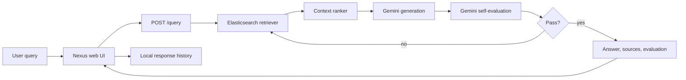

# UI Architecture

## Product Context

Nexus is a closed-loop RAG operations workspace. The application retrieves indexed source chunks from Elasticsearch, ranks the context, generates grounded answers with Gemini, evaluates answer quality, and records pipeline metrics. The interface is designed for AI engineers, knowledge operations teams, and technical business users who need to inspect why an answer was produced.

## Primary Personas

- AI engineer: validates retrieval quality, prompt behavior, evaluation outcomes, and latency.
- Knowledge operator: uploads documents, checks indexed content, and verifies source coverage.
- Business reviewer: asks questions, inspects citations, and downloads response history.

## Information Hierarchy

1. Pipeline status and model/index configuration.
2. Query workspace and generated answer.
3. Retrieved chunks and source document detail.
4. Self-evaluation, confidence, and feedback loop state.
5. Document ingestion and indexed document inventory.
6. Metrics and response history.

## Navigation Structure

The UI is a single-page operational console served at `/app`.

- Top status bar: service health, Gemini model, Elasticsearch index, last refresh.
- Query workspace: question input, run control, answer output, response history download.
- Evidence explorer: retrieved chunks, source metadata, score, selected chunk preview.
- Evaluation panel: verdict, confidence score, groundedness, completeness, missing topics, unsupported claims.
- Metrics panel: query count, latency, source count, document count, pass rate.
- Document panel: upload documents, view indexed documents, refresh list.

## Page Layout

Desktop layout:

- Header row with status and quick metrics.
- Main two-column workspace.
- Left column: query composer, answer, retrieval explorer.
- Right column: self-evaluation, pipeline metrics, document operations.
- Bottom row: feedback loop timeline and response history controls.

Mobile layout:

- Header condenses to stacked status pills.
- Query composer remains first.
- Panels become vertical sections in this order: answer, sources, evaluation, metrics, documents.
- Tables convert to compact cards with fixed labels.

## Wireframe Description

```text
+--------------------------------------------------------------+
| Nexus RAG Console | Health | Gemini Model | ES Index          |
+--------------------------------------------------------------+
| Query Workspace                 | Evaluation + Confidence     |
| - Question input                | - Verdict                   |
| - Run query                     | - Score bars                |
| - Answer output                 | - Missing/unsupported lists |
+---------------------------------+----------------------------+
| Retrieval Results Explorer      | Metrics                     |
| - Ranked chunks                 | Document Upload             |
| - Source detail panel           | Indexed Documents           |
+--------------------------------------------------------------+
| Feedback Loop Timeline | Download History                    |
+--------------------------------------------------------------+
```

## Data Flow



## Design System

- Theme: obsidian dark surface, neutral text, neon cyan active accents.
- Secondary signals: green for healthy/pass, amber for partial, red for failed/error.
- Surface style: restrained glass panels with 8px radius, thin borders, and minimal glow.
- Motion: short opacity/translate transitions for loading, panel updates, and history insertion.
- Typography: system UI stack for enterprise readability, tabular numbers for metrics.
- Components: status pills, score bars, timeline nodes, chunk cards, document cards, toast alerts.

## Backend Capability Alignment

The UI only exposes features backed by REST endpoints:

- Ask questions through `POST /query`.
- Evaluate generated responses through `POST /evaluate`.
- Upload documents through `POST /documents`.
- View indexed documents through `GET /documents`.
- Inspect service state through `GET /health`.
- Inspect pipeline metrics through `GET /metrics`.

